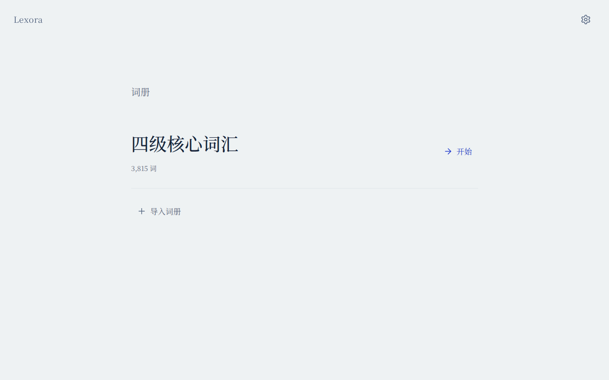
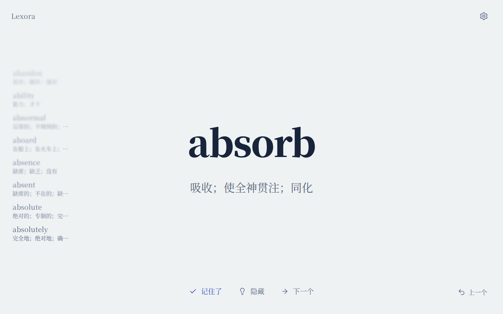
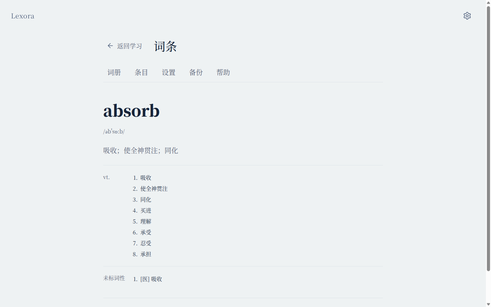
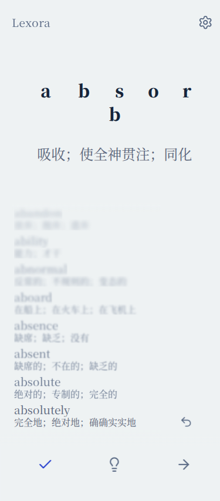

<div align="center">

# 📖 Lexora

### 在一页留白里，记住词汇与知识

**中文界面 · 静态网页 · 本地保存 · JSON 词册 · 思源宋体**

<p>
  <strong>导航</strong><br/>
  <a href="https://qrzzzz.github.io/lexora/">在线使用</a> ·
  <a href="./examples/first-dictionary.json">3815 词样例</a> ·
  <a href="./docs/deck-format.md">词册格式</a> ·
  <a href="#主要功能">主要功能</a> ·
  <a href="#本地开发">本地开发</a> ·
  <a href="./LICENCE">许可证</a>
</p>

[](https://github.com/Qrzzzz/lexora/actions/workflows/check.yml)
[](https://github.com/Qrzzzz/lexora/actions/workflows/pages.yml)

</div>

---

<details>
<summary><strong>🖥️ 界面预览</strong></summary>





<table>
  <tr>
    <td width="70%" align="center" valign="top"><br/><sub>词条详情</sub></td>
    <td width="30%" align="center" valign="top"><br/><sub>移动端</sub></td>
  </tr>
</table>

</details>

## 🌐 在线使用

打开 **[qrzzzz.github.io/lexora](https://qrzzzz.github.io/lexora/)** 即可开始，无需安装或登录。

首页选择要学习的词册，再点击开始或继续。内置完整的四级核心词汇样例，也可导入自己的 JSON 文件。网页由 GitHub Pages 托管，词册解析与学习都在浏览器中完成。

<a id="主要功能"></a>

## ✨ 主要功能

### 📚 词册与词条

- 支持词汇和知识卡片，按词册分别保存学习进度。
- 学习页显示简短释义；点击词目，查看音标、不同词性与完整释义。
- 支持本地 JSON 导入、导入预览、格式校验和词册修订更新；兼容早期 JSON / JSONL。
- 支持搜索、已掌握筛选、恢复已记住条目。不加入例句或在线词典接口。

### ✍️ 学习与交互

- 翻面回想、词汇拼写、原序与乱序。
- 记住时切片飞散，撤回时切片合拢；回到上一个词采用反向翻页。划线从右上向左下，支持可点击回顾；[动效与原文适配说明](./docs/original-motion.md)。
- 放大触控区域，使用可变字重与荧光笔反馈；标签页按左右方向切换，历史文字保持清晰并在边缘渐隐。
- 桌面支持键盘与鼠标；窄屏底部仅保留记住、灯泡提示、下一个三个图标。回顾不改变正在学习的位置。
- 设置、词册、条目和备份使用页面内视图。首页保持留白，界面暂只提供中文。

空格切到下一个，Enter 显示或隐藏释义；X 记住了，U 撤回。手机可直接点按底部操作。

历史最多显示最近 8 条，从底部接入并逐条上移，越往上越模糊，悬停时清晰。默认显示短释义，也可在设置中改为仅显示单词；长释义在安全宽度内省略。加载页直接复用个人文档站的[诗歌播放器与诗库](./docs/loading-source/README.md)。

### 🔤 阅读与保存

- 全站自托管思源宋体，默认跟随系统，使用文档站的浅蓝白与深蓝配色，也可手动选择；纸纹已移除。
- 大单词的悬停字重参考 [React Bits Text Pressure](https://reactbits.dev/c/text-animations/text-pressure)，仅在鼠标悬停时响应，固定字宽避免抖动，不额外加载字体或 React。
- 动效跟随系统的减少动态效果设置，也可手动关闭。
- 设置、下一个、记住、撤回采用不同震动模式，提供独立开关。音效暂未启用，设置保留「后续开发」入口，当前不加载或播放音效。
- 网页震动取决于浏览器能力，iPhone Safari 不支持；不支持时显示说明，不影响视觉反馈。
- 进度保存在当前浏览器的 IndexedDB；可自行导出词册或包含词册、进度、偏好的完整备份。

没有账号、云同步或跨设备共享。更换浏览器、清理网站数据前，请先导出完整备份。本地导入文件不上传，网站不调用 AI API。

## 📘 首个词册样例

内置「WordTyper 四级核心词表」，完整转换固定来源的 **3,815 个词目、8,186 组释义**，没有抽样截取。

- 3,805 词带原始音标；10 词缺失，按原样留空。
- 按来源保留词性与多义；来源未标词性的内容显示为「未标词性」。
- 短释义最多取前三个义项、32 字以内，完整内容始终保留在词条详情中。
- 来源是 [WordTyper Vocabularies](https://github.com/grhliu/wordtyper-vocabularies) 的 CET-4 核心词表，上游声明派生自 [ECDICT](https://github.com/skywind3000/ECDICT)。这是该来源的完整核心词册，不代表官方四级大纲全部词汇。

数据保留来源的拼写与旧式音标，未经过专家校订。固定版本、许可、缺项与重现方式见[样例说明](./docs/sample-dictionary.md)及[数据声明](./data/NOTICE.md)。

## 🧩 词册格式

词册内容与个人进度分开。v2 词汇条目的核心字段为：

```json
{
  "id": "book",
  "type": "vocabulary",
  "term": "book",
  "shortDefinition": "书；预订",
  "pronunciations": [
    { "system": "ipa", "region": "general", "value": "/bʊk/" }
  ],
  "senses": [
    { "id": "noun-1", "partOfSpeech": "n.", "definitions": ["书", "账簿"] },
    { "id": "verb-1", "partOfSpeech": "v.", "definitions": ["预订", "登记"] }
  ]
}
```

导入文件还需要词册元数据和 cards 数组，见[完整规范](./docs/deck-format.md)、[JSON Schema](./schemas/deck-v2.schema.json)和[最小示例](./examples/dictionary-v2.json)。词册、词条和义组使用稳定 ID；更新时递增 revision，未变条目保留进度。v1 词册继续兼容。

<a id="本地开发"></a>

## 🛠️ 本地开发

需要 Node.js 22 或更高版本：

```sh
npm ci
npm run dev
```

默认地址为 `http://127.0.0.1:4173`。运行时没有第三方 JavaScript 依赖，开发依赖 Ajv 用于 Schema 测试；请通过 HTTP(S) 访问，不要直接双击 HTML。

```sh
npm test
python data/build_first_dictionary.py
node scripts/package-site.mjs
```

词表脚本只使用 Python 标准库，校验固定来源散列，可重复生成同一文件。最后一条命令输出 `output/site/`，可部署到普通静态托管服务。

推送 main 会自动运行检查和 Pages 发布；也支持手动触发。发布前校验格式、学习规则与词表可重复生成性，站点的 `build-info.json` 记录对应提交与词册散列。

[贡献说明](./CONTRIBUTING.md) · [本地验证记录](./docs/validation.md)

## 🙏 致谢

感谢 [思源宋体](https://github.com/adobe-fonts/source-han-serif) 提供字体支持，感谢 [WordTyper Vocabularies](https://github.com/grhliu/wordtyper-vocabularies) 与 [ECDICT](https://github.com/skywind3000/ECDICT) 提供首个样例的数据基础。

界面图标使用 [Lucide](https://lucide.dev)，所需 SVG 随项目自托管，无需外部 CDN。

大单词的字重距离响应参考 [React Bits Text Pressure](https://github.com/DavidHDev/react-bits/tree/main/src/content/TextAnimations/TextPressure)，在本应用内用原生 JavaScript 适配，遵循其 [MIT + Commons Clause 许可](./assets/REACT-BITS-LICENSE.md)。

## 📄 许可证

项目沿用 [Lexora Non-Commercial License](./LICENCE)。内置思源宋体独立遵循 [SIL Open Font License 1.1](./assets/FONT-LICENSE.txt)，样例数据独立遵循其 [MIT 许可与来源声明](./data/NOTICE.md)，Lucide 图标遵循其 [ISC 与 MIT 许可](./assets/icons/LICENSE)，均不适用项目的非商业限制。
